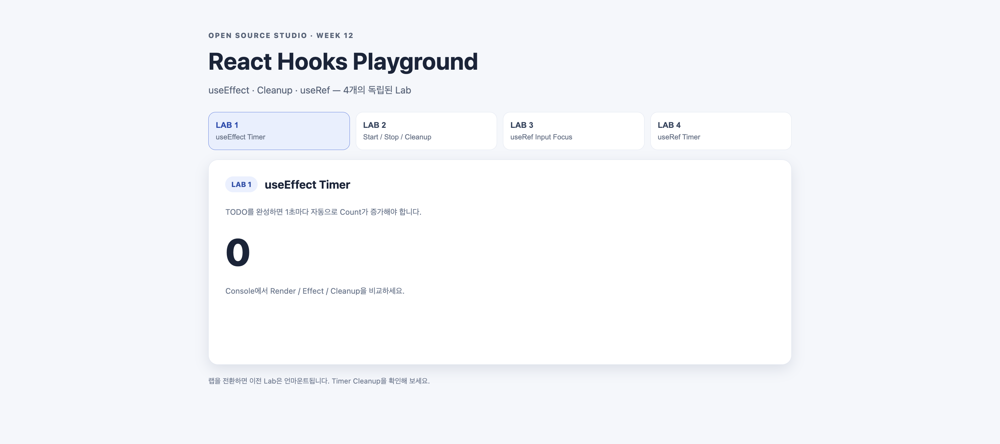
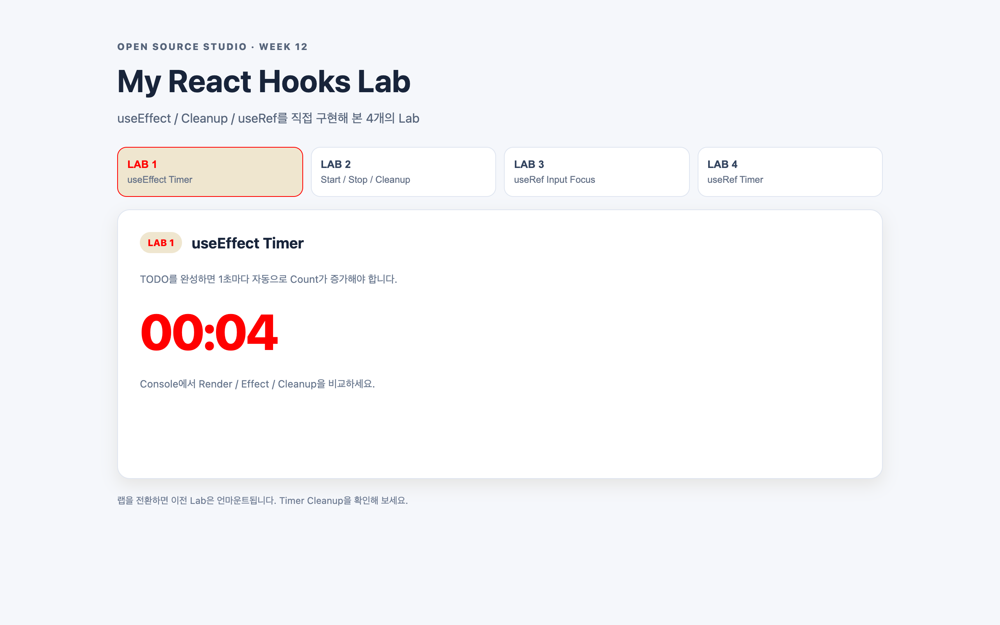
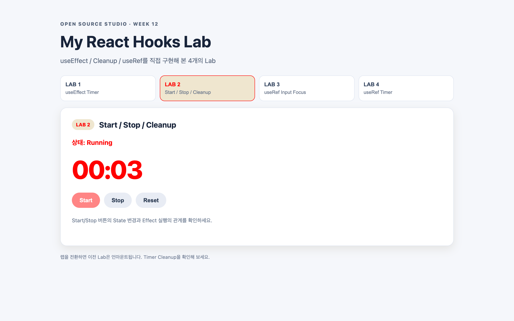
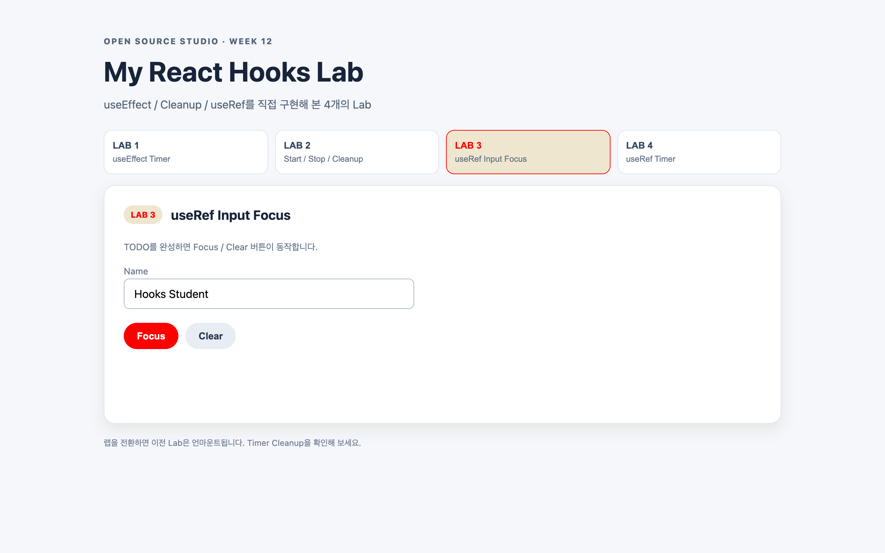
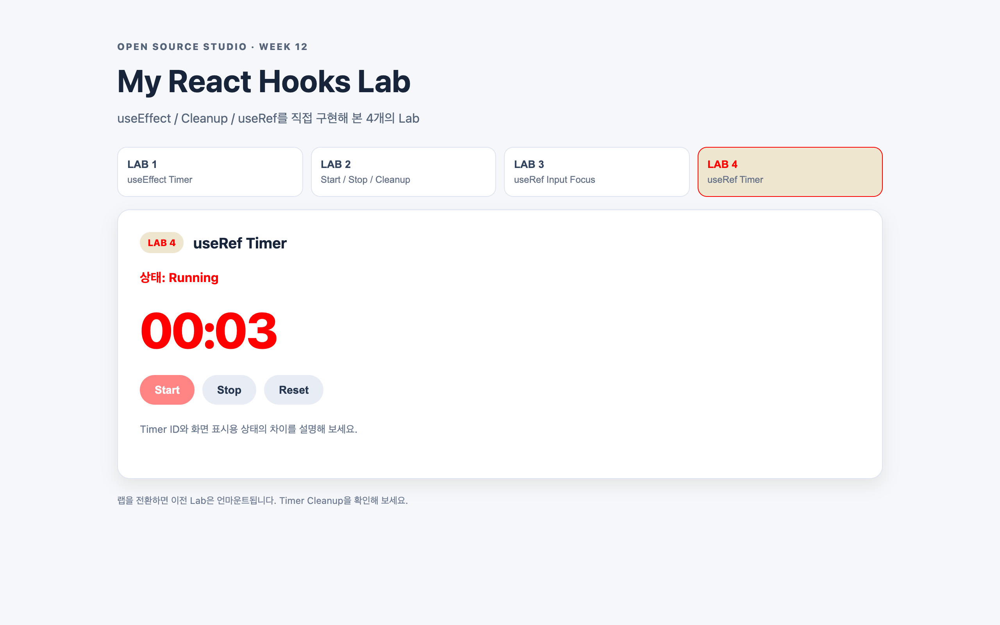

# OSS Week 12 — React Hooks Playground (Student Starter)

GitHub(조직): https://github.com/2026-2-OSS/assign12-c01-22300378.git
GitHub(개인): https://github.com/ggm77/week12_starter_project.git
Vercel: https://week12-starter-project-delta.vercel.app/

## Project Information: 프로젝트 소개 및 Starter Project 정보
OSS 12주차 React Hooks 실습 프로젝트이다. 제공된 Starter Project의 4개 Lab TODO를 완성하며 `useEffect`와 `useRef`의 동작을 익힌다.

- LAB 1: useEffect Timer — 1초마다 count 자동 증가
- LAB 2: Timer Start / Stop / Reset — `running` State와 Dependency Array로 타이머 제어
- LAB 3: Input Focus — `useRef`로 input DOM에 직접 접근
- LAB 4: Timer with useRef — Timer ID를 `useRef`에 보관하고 Event Handler에서 직접 제어

Starter Project는 Vite + React 19로 구성되어 있고, `src/App.jsx`가 탭으로 Lab을 전환하는 화면을, `src/components/`의 Lab 파일들이 각 실습 내용을 담당한다.

## Installation: 설치·실행 방법 및 실행 화면
Node.js 20.19+ 또는 22.12+ 환경에서 프로젝트 폴더에서 실행한다.

```bash
npm install
npm run dev      # 개발 서버 실행 후 터미널의 Local URL 접속
npm run build    # 배포용 빌드
```

초기 실행 화면 (Starter Project, TODO 구현 전)



## Source Code Exploration: 주요 파일 구조, useEffect 및 useRef 분석, 주요 코드 2개 설명

### Project Structure: App.jsx와 주요 Lab 컴포넌트의 역할
App.jsx는 Lab 컴포넌트들을 한 화면에서 보여주기 위한 틀이고, Lab 컴포넌트들은 실제 화면에서 보여질 주요 동작이 정의된 컴포넌트 들이다. 페이지 이동 없이 한 페이지 내에서 컴포넌트를 마운트/언마운트 해가며 컴포넌트를 보여준다.

### useEffect: Effect, Dependency Array 및 Cleanup의 동작 원리
- **Effect**: `useEffect(fn, deps)`에 전달한 함수는 렌더링 중이 아니라, 렌더링 결과가 화면에 반영된 이후에 실행된다. 타이머 등록, 네트워크 요청, 이벤트 구독처럼 렌더링과 무관한 요청을 이곳에서 처리한다.
- **Dependency Array**: Effect를 언제 다시 실행할지 결정한다.
  - `[]` : 마운트될 때 한 번만 실행된다.
  - `[a, b]` : 마운트 시 실행되고, 이후 `a`나 `b`의 값이 바뀐 렌더링 뒤에만 다시 실행된다.
  - 생략 : 매 렌더링마다 실행된다.
- **Cleanup**: Effect 함수가 반환하는 함수이다. 컴포넌트가 언마운트될 때, 그리고 의존성이 바뀌어 Effect가 다시 실행되기 직전에 호출되어 이전 Effect가 만든 것들을 정리한다. 정리하지 않으면 Lab 이전 Effect의 정보들이 남아 현재의 Effect에 영향을 미친다.

### useRef: .current 속성과 useState의 차이
- `useRef(initialValue)`는 `{ current: initialValue }` 형태의 객체를 반환하며, 이 객체는 컴포넌트가 다시 렌더링되어도 같은 객체가 유지된다.
- 값은 `.current` 속성에 저장하고 직접 읽고 쓴다. JSX에 `ref={inputRef}`로 연결하면 React가 해당 DOM 요소를 `inputRef.current`에 넣어 주므로 `inputRef.current.focus()`처럼 DOM을 직접 조작할 수 있다.

- `useState`는 `setState`로 값을 바꾸면 리렌더링이 일어나고 새 값은 다음 렌더링부터 반영된다. 반면 `useRef`는 `.current`를 바꿔도 리렌더링이 일어나지 않고 값이 즉시 반영된다.

### Code Analysis: useEffect와 useRef 관련 주요 코드 각 1개(5~15줄)를 선택하여 동작 원리 설명

#### 1) useEffect — `src/components/Lab1_EffectTimer.jsx`
```jsx
useEffect(() => {
  const id = setInterval(() => {
    setCount(count => count + 1);
  }, 1000);

  return () => {
    clearInterval(id);
  };
}, []);
```
- 컴포넌트가 마운트된 뒤 Effect가 실행되어 1초 간격의 Interval을 등록하고 Timer ID를 `id`에 보관한다.
- Dependency Array가 `[]`이므로 count가 바뀌어 리렌더링되어도 Effect는 다시 실행되지 않는다. 그래서 Effect 안의 함수는 처음 렌더링 때의 count(0)만 기억하는데, 업데이트 함수 형태(`count => count + 1`)를 쓰면 React가 최신 State를 인자로 넘겨주므로 정상적으로 1씩 증가한다.
- 다른 Lab 탭으로 이동해 언마운트되면 Cleanup에서 `clearInterval(id)`가 호출되어 타이머가 정리된다.

#### 2) useRef — `src/components/Lab4_RefTimer.jsx`
```jsx
const timerRef = useRef(null);

const start = () => {
  if (timerRef.current !== null) return;
  timerRef.current = setInterval(() => {
    setCount(prev => prev + 1);
  }, 1000);
  setRunning(true);
};

const stop = () => {
  clearInterval(timerRef.current);
  timerRef.current = null;
  setRunning(false);
};
```
- `timerRef`는 리렌더링되어도 같은 객체로 유지되므로, `start`에서 저장한 Timer ID를 `stop`에서 그대로 꺼내 쓸 수 있다. 일반 지역 변수는 렌더링마다 새로 만들어져 ID를 잃어버린다.
- `.current`에 값을 넣어도 리렌더링이 일어나지 않는다. Timer ID는 화면에 표시할 필요가 없으므로 Ref로 관리한다.
- `.current`는 대입 즉시 반영되므로 `timerRef.current !== null` 검사로 타이머 중복 실행을 막는다.

## Lab Implementation: 4개 Lab 구현 내용 및 실행 결과

### LAB 1. useEffect Timer — `Lab1_EffectTimer.jsx`
- `useEffect` 안에서 `setInterval`로 1초마다 Functional State Update(`setCount(count => count + 1)`)를 실행한다.
- Dependency Array `[]`로 마운트 시 한 번만 타이머를 등록하고, Cleanup에서 `clearInterval`로 정리한다.
- 실행 결과: 화면을 열면 1초마다 count가 자동으로 증가한다.



### LAB 2. Timer Start / Stop / Reset — `Lab2_TimerControl.jsx`
- `running` State를 Dependency Array에 넣어, `running`이 바뀔 때마다 Effect가 다시 실행되도록 했다.
- `running`이 `false`면 Effect가 바로 return하여 타이머를 만들지 않고, `true`면 `setInterval`을 등록한다. Cleanup에서 이전 타이머를 정리한다.
- Reset은 `setRunning(false)`로 타이머를 멈추고 `setCount(0)`으로 초기화한다.
- 실행 결과: Start를 누르면 count가 증가하고, Stop을 누르면 멈추며, Reset을 누르면 멈추고 0이 된다. 실행 중에는 Start 버튼이 비활성화되어 타이머가 중복 실행되지 않는다.



### LAB 3. Input Focus with useRef — `Lab3_InputFocus.jsx`
- `useRef(null)`로 만든 `inputRef`를 `<input ref={inputRef}>`에 연결해 실제 input DOM 요소를 참조한다.
- Focus 버튼은 `inputRef.current.focus()`, Clear 버튼은 `inputRef.current.value = ""` 후 다시 `focus()`를 호출한다.
- 실행 결과: Focus를 누르면 입력창에 커서가 이동하고, Clear를 누르면 입력 내용이 지워진 뒤 커서가 입력창에 유지된다.



### LAB 4. Timer with useRef — `Lab4_RefTimer.jsx`
- `setInterval`이 반환한 Timer ID를 `timerRef.current`에 보관하고, `start`/`stop`/`reset` Event Handler에서 직접 타이머를 제어한다.
- `start`는 `timerRef.current`가 비어 있을 때만 타이머를 만들어 중복 실행을 막고, `stop`은 `clearInterval` 후 `timerRef.current`를 `null`로 되돌린다.
- `useEffect(() => () => clearInterval(...), [])`의 Cleanup으로 언마운트 시 남은 타이머를 정리한다.
- 실행 결과: Start / Stop / Reset이 LAB 2와 같게 동작하며, Stop 후 다시 Start할 수 있다.



## Lab Comparison: STEP 3의 비교 분석 질문 4개에 대한 답변

### 1. useEffect의 Dependency Array가 필요한 이유는?
Effect를 언제 다시 실행할지 정하기 위해서이다. Dependency Array가 없으면 Effect가 매 렌더링마다 실행되어, Effect 안에서 State를 바꾸면 렌더링 -> Effect -> State 변경 -> 렌더링이 끝없이 반복될 수 있다.

### 2. Cleanup을 사용하지 않으면 어떤 문제가 발생할 수 있는가?
이전 Effect가 만든 타이머가 정리되지 않고 계속 남는다. 다른 Lab 탭으로 이동해 컴포넌트가 언마운트되어도 Interval이 계속 실행되어 메모리 누수가 생기고, LAB 2처럼 Effect가 다시 실행되는 경우에는 이전 타이머 위에 새 타이머가 추가되어 count가 1초에 여러 번 증가하게 된다.

### 3. useState와 useRef의 가장 중요한 차이는?
값이 바뀔 때 리렌더링이 일어나는지의 여부이다. `useState`는 값이 바뀌면 컴포넌트를 다시 렌더링하므로 화면에 보여줄 값(`count`, `running`)에 사용한다. `useRef`는 `.current`를 바꿔도 리렌더링이 일어나지 않고 렌더링 사이에 값만 유지되므로, 화면에 표시할 필요가 없는 값(Timer ID, DOM 요소)을 보관하는 데 사용한다.

### 4. LAB 2와 LAB 4의 Timer 관리 방식은 어떻게 다른가?
LAB 2는 `useEffect` + Dependency Array 방식이다. 버튼은 `running` State만 바꾸고, `running`이 바뀌면 Effect가 타이머를 만들고 Cleanup이 타이머를 정리한다. 즉, 상태 변화에 따라 타이머가 자동으로 생성·정리된다.

LAB 4는 `useRef` + Event Handler 방식이다. `start`/`stop` 함수가 직접 `setInterval`/`clearInterval`을 호출하고, Timer ID는 `timerRef.current`에 보관한다. 중복 실행은 `timerRef.current`가 비어 있는지로 직접 막고, `useEffect`는 언마운트 시 남은 타이머를 정리하는 용도로만 사용한다.

## Customizing: 수정 내용 및 파일명

### 제목 및 설명 변경 — `src/App.jsx`
- 제목: `React Hooks Playground` → `My React Hooks Lab`
- 설명: `useEffect · Cleanup · useRef — 4개의 독립된 Lab` → `useEffect / Cleanup / useRef를 직접 구현해 본 4개의 Lab`

### CSS 스타일 변경 — `src/App.css`
- 파란색 계열 포인트 색상을 빨간색(`#ff0000`)으로 변경했다. (`.eyebrow`, `.tab.active`, `.pill`, `.count`, `.controls button`, `.status`)
- 선택된 탭과 LAB 배지의 배경을 아이보리색(`#efe6cf`)으로, 패널 그림자를 갈색 계열(`#6b5a3020`)로 변경했다.
- 버튼 모서리를 더 둥글게 변경했다. (`border-radius: 9px` → `20px`)

### 선택 기능: Timer Count를 분/초 형식으로 표시 — `src/utils/formatTime.js`
- 초 단위 count를 `MM:SS` 문자열로 바꾸는 `formatTime` 함수를 만들었다. (예: 75 → `01:15`)
- `Lab1_EffectTimer.jsx`, `Lab2_TimerControl.jsx`, `Lab4_RefTimer.jsx`에서 `{count}` 대신 `{formatTime(count)}`로 표시한다. count State는 그대로 초 단위 숫자이고 화면에 표시할 때만 변환하므로 타이머 로직은 바뀌지 않는다.

## Deployment: 실제 접근 가능한 Vercel URL
Vercel: https://week12-starter-project-delta.vercel.app/

## Weekly Review:
- 새롭게 배운 내용 3가지
  1. `useEffect`의 Dependency Array로 Effect 재실행 시점을 정하고, Cleanup으로 이전 Effect가 만든 타이머를 정리해야 한다는 것.
  2. Dependency Array가 `[]`인 Effect 안에서는 처음 렌더링 때의 State만 보이는 stale closure 문제가 생기며, `setCount(prev => prev + 1)` 같은 Functional State Update로 해결할 수 있다는 것.
  3. `useRef`는 값이 바뀌어도 리렌더링되지 않으므로, 화면에 보여줄 값은 `useState`로, Timer ID나 DOM 요소처럼 화면과 무관한 값은 `useRef`로 관리해야 한다는 것.
- 어려웠던 점과 해결 방법
  - 개발 환경에서 Effect가 두 번 실행되는 이유를 처음에 이해하지 못했다. Console 로그를 찍어 보고 StrictMode가 Cleanup이 제대로 작성되었는지 확인하기 위해 `effect → cleanup → effect`를 한 번 더 실행한다는 것을 알게 되었다.
  - LAB 2와 LAB 4가 같은 동작을 하는데 차이가 무엇인지 헷갈렸다. LAB 2는 State 변화에 따라 Effect가 타이머를 관리하고, LAB 4는 Event Handler가 Ref로 타이머를 직접 관리한다는 점으로 정리했다.
- AI 활용 내용 및 느낀 점
  - Claude Code를 활용해 작성한 LAB 코드 검토, CSS 포맷팅 및 코드 검토를 진행했다.
  - AI가 작성한 코드와 설명을 그대로 쓰지 않고 강의자료와 비교하며 직접 확인했다.